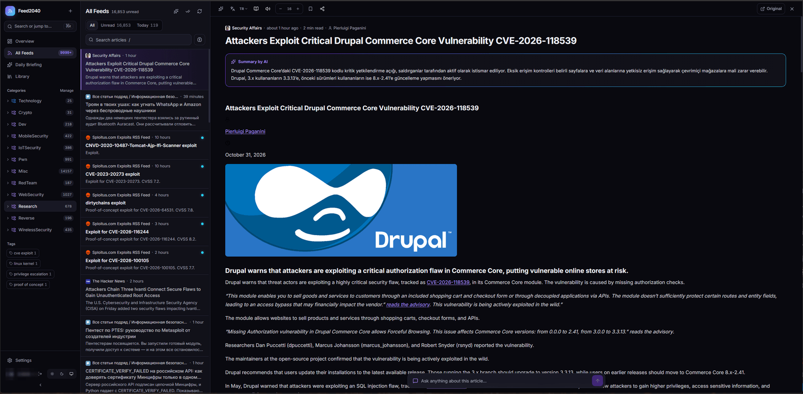
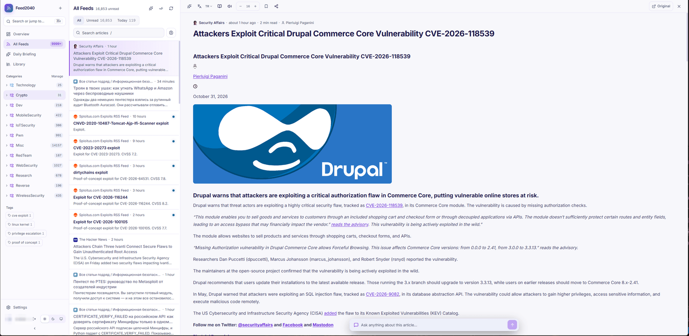
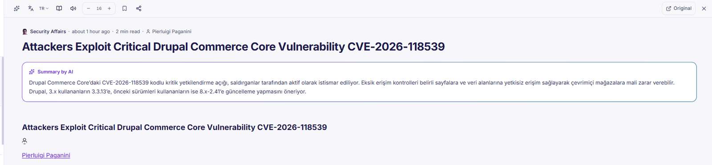
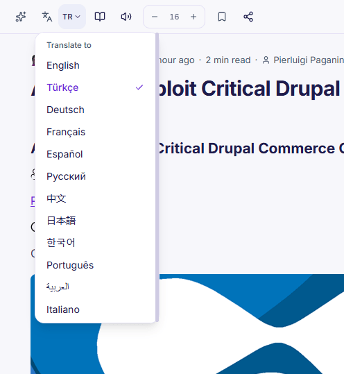
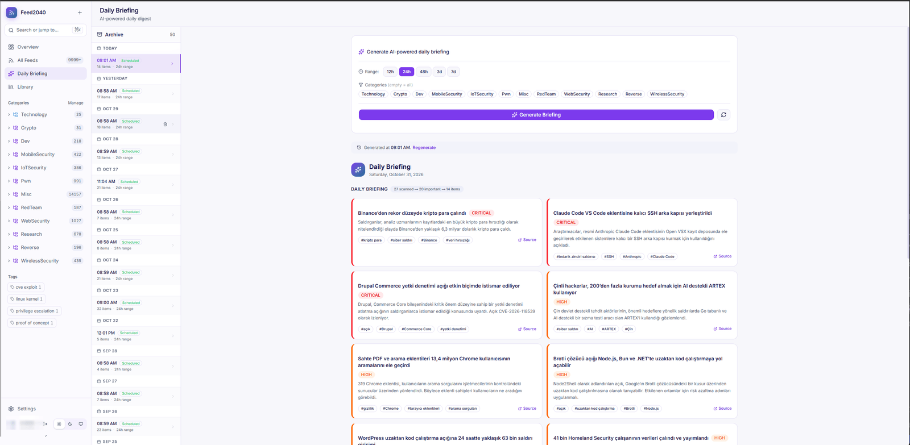
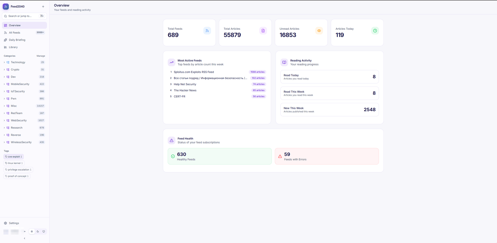
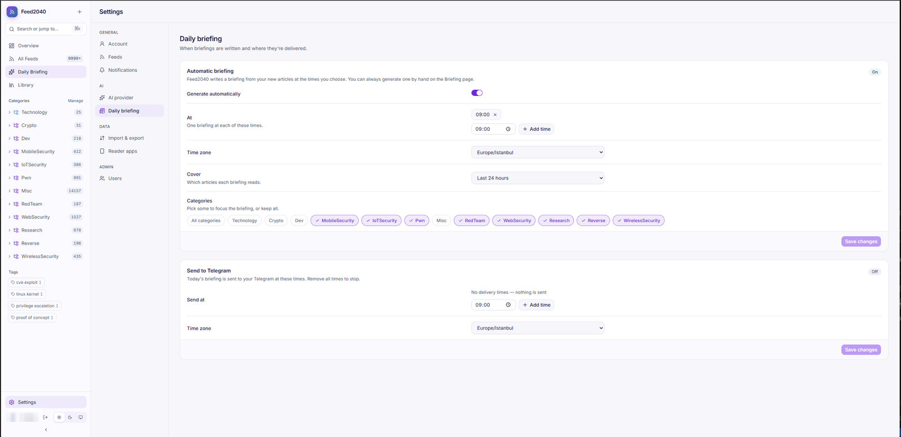

<p align="center">
  
  
  
  
  
</p>

# Feed2040

**A self-hosted, AI-powered RSS reader with daily briefings, translation, Telegram delivery and a fast three-panel interface.**

Feed2040 collects your feeds, summarizes and ranks articles with any OpenAI-compatible model, writes a daily briefing, and sends alerts and briefings to Telegram or your browser — all on your own server.

---

## Features

**Reading**
- **Three-panel reader** — sidebar, article list and a full-width reading pane, with reader mode, adjustable font size and read-aloud.
- **Full text** — fetch the complete article for feeds that only publish excerpts (per feed).
- **Translation** — translate any article into 12 languages; uses Google Translate and falls back to your AI model.
- **Highlights** — highlight passages while reading and export them as Markdown (Obsidian-friendly).
- **Library** — bookmarks plus saved links: keep any web page for later, also from a bookmarklet.
- **Organize & find** — nested categories with colors and icons, tags, saved searches, Unread/Today filters and related articles.
- **Share** — copy or download an article as Markdown or plain text, or use the system share sheet.
- **Keyboard first** — ⌘K / Ctrl+K command palette and single-key shortcuts.

**AI** (any OpenAI-compatible API: OpenAI, Ollama, OpenRouter, LiteLLM, …)
- **Summaries & Ask AI** — summarize an article or ask questions about it.
- **Daily briefings** — scheduled, importance-ranked briefings, optionally limited to certain categories.
- **Suggestions** — tag and category suggestions for articles and feeds.

**Alerts & delivery**
- **Alert rules** — keyword rules that notify you and can also mark as read, bookmark or tag matching articles.
- **Browser notifications** — web push on desktop and mobile (installable as a PWA).
- **Telegram bot** — alerts, scheduled briefings and on-demand `/digest`.

**Your data**
- **Import & export** — OPML in and out, JSON backup, Markdown export of highlights.
- **Reader apps** — sync with Reeder, Readrops, Fluent Reader, Read You and other Fever-API clients.
- **Housekeeping** — feed health with retry, automatic article retention, overview of reading stats.
- **Multi-user** — each user has their own feeds, AI key and Telegram bot; admins manage accounts and sign-ups.
- **Dark & light themes**, responsive layout with a mobile tab bar, deploy with a single `docker compose up`.

---

## Screenshots

### Three-Panel Feed Reader


### Light Theme


### AI Summary


### Article Translation


### AI-Powered Daily Briefing


### Overview


### Settings


---

## Quick Start

### Prerequisites

- **Docker** and **Docker Compose** (v2+)
- 1 GB RAM minimum (2 GB recommended if using local AI)
- *(Optional)* Ollama for local AI summarization

### 1. Clone the repository

```bash
git clone https://github.com/0xhav0c/Feed2040.git
cd Feed2040
```

### 2. Configure environment

```bash
cp .env.example .env
```

Edit `.env` and set the required secrets:

```bash
# Generate required secrets
openssl rand -base64 32   # → NEXTAUTH_SECRET
openssl rand -hex 24      # → CRON_SECRET
```

### 3. Start the application

```bash
docker compose up -d
```

That's it. Open [http://localhost:3000](http://localhost:3000) and create your account.

---

## Configuration

### Environment Variables

| Variable | Default | Description |
|----------|---------|-------------|
| `POSTGRES_USER` | `feed2040` | PostgreSQL username |
| `POSTGRES_PASSWORD` | `feed2040` | PostgreSQL password |
| `POSTGRES_DB` | `feed2040` | Database name |
| `APP_PORT` | `3000` | Application port |
| `NEXTAUTH_URL` | `http://localhost:3000` | Full application URL |
| `NEXTAUTH_SECRET` | — | **Required.** Generate with `openssl rand -base64 32` |
| `REFRESH_INTERVAL_MINUTES` | `15` | How often feeds are refreshed |
| `CRON_SECRET` | — | **Required.** Generate with `openssl rand -hex 24` |
| `ENCRYPTION_SALT` | — | Optional. Custom salt for API key encryption. Set it before saving any keys — changing it later makes saved keys unreadable |
| `VAPID_SUBJECT` | `mailto:admin@feed2040.local` | Optional. Contact for browser push (`mailto:` or `https:`) |

### AI & Telegram

No environment variables needed: after signing in, set them up in the app under **Settings → AI provider** (API key, endpoint, models) and **Settings → Notifications** (Telegram bot).

> **Multi-user:** Each user sets their own API keys and Telegram bot in Settings.

---

## AI Providers

Feed2040 talks to any **OpenAI-compatible** API. Set it up under **Settings → AI provider**: paste an API key, optionally an endpoint, then pick the models for summaries and briefings (the model list is loaded from your provider).

| Provider | Endpoint | Notes |
|----------|----------|-------|
| **OpenAI** | leave empty | Pay per token |
| **Ollama** (local) | `http://<ollama-host>:11434/v1` | Free, runs on your hardware; no API key needed |
| **OpenRouter, LiteLLM, other proxies** | the proxy's `/v1` URL | Use Claude, Gemini, DeepSeek and others through one key |

### Using Ollama (local AI)

1. Install [Ollama](https://ollama.ai) and pull a model: `ollama pull gemma3:12b`
2. In **Settings → AI provider**, set the endpoint to `http://<your-host-ip>:11434/v1`
3. Enter the model name (e.g. `gemma3:12b`) and press **Test connection**

> **Docker users:** the app runs in a container, so use the host's LAN IP rather than `localhost`.

---

## Telegram Integration

1. Create a bot with [@BotFather](https://t.me/BotFather) (`/newbot`) and copy its token
2. In **Settings → Notifications → Telegram**, paste the token and press **Create link code**
3. Send the shown `/start …` message to your bot — the account is now linked
4. Choose delivery times under **Settings → Daily briefing → Send to Telegram**
5. Optionally tick **Send a Telegram message too** on your alert rules

Bot commands: `/digest` (briefing now), `/status`, `/stop` (unlink), `/help`.

---

## Reader Apps (Fever API)

1. In **Settings → Reader apps**, set a Fever password (separate from your login password)
2. In your app, choose **Fever** as the service and enter the server URL shown there (`https://your-host/api/fever`), your username and the Fever password

---

## Keyboard Shortcuts

| Key | Action | Key | Action |
|-----|--------|-----|--------|
| `j` / `k` | Next / previous article | `r` | Refresh feeds |
| `o` | Open original | `Shift+A` | Mark all read in view |
| `b` | Bookmark | `n` / `p` | Next / previous page |
| `m` | Toggle read | `/` | Focus search |
| `s` | AI summary | `Esc` | Close article |
| `t` | Translate | `?` | Show shortcuts |

`⌘K` / `Ctrl+K` opens the command palette to jump to any page, category or feed.

---

## Architecture

```
┌────────────────────────────────────────────────┐
│                  Docker Compose                 │
├──────────┬──────────────┬──────────────────────┤
│ PostgreSQL│    Redis     │    Next.js App       │
│   :5432   │    :6379     │      :3000           │
│           │              │                      │
│  Articles │  Cache       │  ┌─ App Router       │
│  Feeds    │  Rate limits │  ├─ API Routes       │
│  Users    │              │  ├─ Cron Worker       │
│  Digests  │  Locks       │  └─ Telegram Poller   │
└──────────┴──────────────┴──────────────────────┘
                                    │
                          ┌─────────┼──────────────┐
                          ▼         ▼              ▼
                       Ollama    OpenAI    OpenAI-compatible
                       (local)   (cloud)   proxy (LiteLLM, …)
```

### Tech Stack

- **Framework:** Next.js 16 (App Router, React 19)
- **Database:** PostgreSQL 16 + Prisma ORM
- **Cache:** Redis 7
- **UI:** shadcn/ui (Base UI), Tailwind CSS 4, Inter, Lucide icons
- **Auth:** Auth.js / NextAuth v5 (credentials, JWT sessions)
- **AI:** OpenAI SDK against any OpenAI-compatible endpoint
- **Notifications:** Telegraf (Telegram Bot API), Web Push

---

## Development

### Local Setup (without Docker)

You need PostgreSQL 16 with the `pgvector` extension available (the `pgvector/pgvector:pg16` image works) and Redis 7. Put `DATABASE_URL`, `REDIS_URL`, `NEXTAUTH_SECRET` and `CRON_SECRET` in `.env`, then:

```bash
npm install
npx prisma generate
node --env-file=.env scripts/migrate.js   # apply database migrations
npm run dev
```

### Available Commands

| Command | Description |
|---------|-------------|
| `npm run dev` | Start development server with hot reload |
| `npm run build` | Create production build |
| `npm run start` | Start production server |
| `npm run lint` | Run ESLint |

### Project Structure

```
src/
├── app/
│   ├── (auth)/          # Login, register, setup pages
│   ├── (dashboard)/     # Main app pages
│   │   ├── feeds/       # Three-panel RSS reader
│   │   ├── briefing/    # Daily briefing with history
│   │   ├── bookmarks/   # Library: bookmarks and saved links
│   │   ├── categories/  # Category management
│   │   ├── dashboard/   # Overview and stats
│   │   └── settings/    # Settings sections
│   └── api/             # API routes
├── components/
│   ├── feed/            # Article list, reading panel, briefing view
│   ├── layout/          # Sidebar, command palette, header
│   ├── settings/        # Settings sections
│   └── ui/              # shadcn/ui components
├── lib/
│   ├── ai/              # AI provider, summaries, briefings
│   ├── rss/             # Fetching, parsing, alerts
│   ├── telegram/        # Bot, digest builder
│   └── hooks/           # Custom React hooks
└── types/               # TypeScript definitions
```

---

## Admin Tools

### Reset Password

```bash
docker compose exec app node scripts/reset-password.js <username> <new-password>
```

---

## Updating

```bash
git pull
docker compose build --no-cache app
docker compose up -d app
```

Database migrations run automatically on container start.

---

## System Requirements

| Component | Minimum | Recommended |
|-----------|---------|-------------|
| **RAM** | 1 GB | 2 GB (4 GB with Ollama) |
| **CPU** | 1 core | 2+ cores |
| **Disk** | 1 GB | 10 GB+ (depends on feed count) |
| **Docker** | 20.10+ | Latest |
| **Docker Compose** | v2.0+ | Latest |

---

## Contributing

Contributions are welcome. Please open an issue first to discuss what you'd like to change.

1. Fork the repository
2. Create your feature branch (`git checkout -b feature/amazing-feature`)
3. Commit your changes (`git commit -m 'Add amazing feature'`)
4. Push to the branch (`git push origin feature/amazing-feature`)
5. Open a Pull Request

---

## License

This project is licensed under the MIT License. See [LICENSE](LICENSE) for details.

---

<p align="center">
  Built with ☕ and RSS feeds.
</p>
